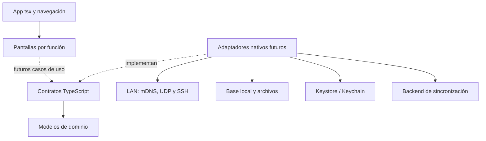

# Arquitectura inicial

## Decisión de entorno

React Native Community CLI, TypeScript y Android como primera plataforma.
La plantilla descargada fija React Native 0.88.0 y React 19.3.0. Se conserva la Nueva
Arquitectura y Hermes de la plantilla. No se promete compatibilidad de las futuras
bibliotecas de red: se validará con una compilación y un ensayo real por módulo.

Community CLI permite inspeccionar Manifest, Gradle y Kotlin directamente. Es útil
para un TP centrado en integración nativa, sockets y generación de APK. Expo con
development build también es viable; Expo Go no puede incorporar nuestros módulos
nativos adicionales. La decisión evita agregar otra capa de configuración al aprendizaje.

React Navigation usa un stack: Inicio -> módulo -> Atrás. Es suficiente para esta
etapa y hace visibles el registro de rutas y los parámetros. No hace falta añadir
tabs, drawer, Redux ni un contenedor de inyección para ocho pantallas iniciales.

## Dependencias instaladas

- React Native 0.88.0, React 19.3.0 y Community CLI 20.2.0.
- React Navigation native 7.5.1 y native-stack 7.21.0.
- react-native-screens 4.30.0 y safe-area-context 5.10.1.
- pnpm 11.25.0 con lockfile y nodeLinker hoisted, tras EPERM de npm en este entorno.
- Bibliotecas de protocolos, evidencia y persistencia: todavía no instaladas.

## Dependencias

Las flechas punteadas indican conexiones pendientes, no servicios ya operativos.
Actualmente la navegación monta pantallas informativas y no crea adaptadores.

| Capa de la consigna | Lugar en el código | Responsabilidad futura |
| --- | --- | --- |
| Discovery | features/discovery | Descubrimiento con límite de tiempo y cancelación |
| Protocol | features/protocols | SNMP y SSH con errores controlados |
| Evidence | features/evidence + identification | Cámara, QR y ubicación |
| Local Store | features/local-store | Lectura local y escrituras atómicas |
| Sync | features/sync | Envío, idempotencia, reintentos y conflictos |
| Reporting | features/reporting | PDF a partir de evidencia local |

Historial es una función de presentación que consulta Local Store; no es una séptima
base de datos. Los adaptadores concretos se alojarán en infrastructure.

## Flujo offline-first previsto

1. El caso de uso valida los datos del técnico.
2. Una transacción local guarda entidad + acción outbox.
3. La UI confirma el guardado local; no espera al servidor.
4. Un worker toma acciones pendientes, carga archivos cuando corresponda y envía.
5. Tras la confirmación del servidor elimina/confirma la acción; los fallos temporales
   se reintentan con backoff y límite. Un conflicto requiere resolución visible.

OutboxAction referencia la entidad y su revisión. Al implementar se deberá conservar
la versión exacta del contenido de cada acción (snapshot inmutable o versionado);
no leer sin más la última revisión de una entidad que cambió después de encolarse.
El id de la acción permanece igual en cada reintento.

Un estado sending que quedó interrumpido al cerrar la app se recuperará como pendiente.
La base debe persistir acciones y datos; un array en memoria no satisface RF07.
NetInfo será una señal para intentar sincronizar; un request exitoso al backend será
la confirmación de alcance. Las fotos/PDF son archivos: una URI local no se sube sola.

## Seguridad y permisos previstos

No hay contraseñas dentro de Device, rutas de navegación ni outbox. Los contratos
de protocolos reciben una referencia a una credencial del almacén seguro.
La implementación deberá validar host keys SSH y usar comandos permitidos por vendor.
Las community strings SNMP también requieren manejo cuidadoso y no deben ir a logs.

En la etapa 1 solo se conserva INTERNET de la plantilla. Cámara, ubicación, estado
de red y multicast se incorporarán al instalar sus adaptadores, con solicitudes en
contexto y según API/target Android. No se solicitan permisos que aún no se usan.

## Bibliotecas candidatas, todavía no instaladas

- Discovery: react-native-zeroconf; evaluar comportamiento de mDNS en LAN real.
- Transporte: react-native-udp y react-native-tcp-socket.
- SSH: react-native-ssh-sftp o alternativa validada; nunca asumir soporte de la
  Nueva Arquitectura por aparecer en la consigna.
- Credenciales: react-native-keychain.
- Evidencia: react-native-vision-camera y geolocation-service; verificar scanner
  soportado por la versión elegida, sin copiar plugins antiguos automáticamente.
- Local Store: WatermelonDB y transacciones para outbox.
- Sync: @react-native-community/netinfo.
- Reporting: react-native-html-to-pdf.

Cada integración deberá tener su prueba de compilación y una operación mínima
en dispositivo antes de continuar. Si una biblioteca no resulta compatible,
documentar una alternativa antes de escribir código dependiente de ella.

## Referencias oficiales consultadas

- [Proyecto sin framework](https://reactnative.dev/docs/getting-started-without-a-framework)
- [Entorno Android](https://reactnative.dev/docs/set-up-your-environment)
- [React Navigation e integración Android](https://reactnavigation.org/docs/getting-started/)
- [Expo development builds](https://docs.expo.dev/develop/development-builds/introduction/)
