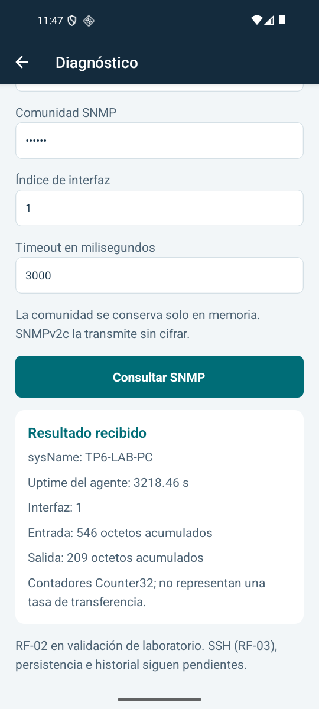

# Consultar SNMP desde el emulador

Esta etapa conecta la app con un agente de laboratorio que se ejecuta en la PC.
Los mensajes viajan realmente por UDP y se codifican como SNMPv2c. El agente y sus
contadores son de laboratorio; esta prueba no acredita un router físico ni completa
la validación de descubrimiento LAN de RF01.

## Prueba rápida

Ejecutar los comandos desde la raíz network-diagnostics-suite:

1. Iniciar el agente en una terminal y mantenerlo abierto: `npm.cmd run lab:snmp`.
2. Mantener Metro abierto con `npm.cmd start` y el emulador encendido.
3. Al incorporar el módulo nativo, reinstalar una vez:
   `npm.cmd run android -- --active-arch-only --no-packager`.
4. En la app, abrir Diagnóstico. Usar IP `10.0.2.2`, puerto `1161`, comunidad
   `public` e interfaz `1`. Pulsar Consultar SNMP.
5. Debe aparecer el nombre `TP6-LAB-PC`, el uptime del agente y sus octetos
   acumulados. Otra consulta puede mostrar contadores mayores; no son bytes/segundo.

El agente escucha solamente en `127.0.0.1` de la PC. Desde el emulador,
`10.0.2.2` identifica ese loopback. `127.0.0.1` en Android identifica al propio
Android, por lo que no es la dirección del agente de Windows.

La consulta, el timeout y la cancelación se probaron desde la app instalada.
El estado detallado de las otras comprobaciones está en [VERIFICACION.md](VERIFICACION.md).



Si Metro muestra un error 500 de su grafo de dependencias, detener esa terminal
y reiniciarlo con `npm.cmd start -- --reset-cache --max-workers 1`. Después
volver a abrir la app. Si el teclado del emulador abre un tutorial de lápiz,
cerrarlo con su botón Cancelar antes de editar los campos.

## Qué ocurre al pulsar Consultar

1. La pantalla recoge un objetivo explícito, un puerto, una comunidad y un índice
   de interfaz. La comunidad no se escribe en disco.
2. El cliente construye un GetRequest con un identificador y cuatro OIDs.
3. El códec convierte la estructura en bytes BER. No realiza conexiones.
4. El módulo Kotlin envía esos bytes por un socket UDP y espera con un plazo.
5. El agente responde; el cliente valida el identificador, la comunidad y los OIDs
   antes de presentar el resultado. Un error no se convierte en un valor cero.

## Los fundamentos

**UDP** envía datagramas. No garantiza entrega ni respuesta; por eso una consulta
necesita timeout y cancelación. Encontrar una IP tampoco demuestra que SNMP esté
habilitado en ella.

Un **OID** identifica un dato de una MIB. El sufijo `.0` señala una instancia
escalar, mientras que los contadores de una tabla usan el índice de su interfaz.

| Dato | OID | Interpretación |
| --- | --- | --- |
| sysName | 1.3.6.1.2.1.1.5.0 | Nombre del agente/equipo |
| sysUpTime | 1.3.6.1.2.1.1.3.0 | Centésimas de segundo desde la inicialización del agente |
| ifInOctets | 1.3.6.1.2.1.2.2.1.10.N | Octetos acumulados de entrada de la interfaz N |
| ifOutOctets | 1.3.6.1.2.1.2.2.1.16.N | Octetos acumulados de salida de la interfaz N |

**BER** representa cada elemento con tipo, longitud y valor. El mensaje contiene
versión, comunidad y una PDU. La PDU incluye request-id, estado de error, índice
de error y una lista de pares OID/valor. Los tipos relevantes son:

| Byte de tipo | Significado |
| --- | --- |
| 0x30 | Secuencia |
| 0x02 | INTEGER |
| 0x04 | OCTET STRING |
| 0x06 | OBJECT IDENTIFIER |
| 0x05 | NULL, para solicitar el valor de un OID |
| 0xA0 / 0xA2 | GetRequest / Response |
| 0x43 / 0x41 | TimeTicks / Counter32 |

El subconjunto usa SNMPv2c, cuyo campo de versión en el mensaje vale `1`.
No implementa SNMPv3, escritura Set, Walk ni enumeración automática de interfaces.
Los Counter32 pueden desbordar al superar 2^32-1; aquí se presentan como contadores
acumulados, sin calcular tasas a partir de una sola muestra.

## Errores que se deben poder comprobar

- Cambiar la comunidad del laboratorio debe terminar sin respuesta y permitir
  volver a intentar. La comunidad no se incluye en logs ni reportes.
- Cancelar una consulta debe detener la espera y permitir una consulta posterior.
- Un índice de interfaz que el laboratorio no ofrece debe mostrar un error de OID,
  sin presentar los contadores como cero.
- Una respuesta truncada, de otra consulta o con otros OIDs debe rechazarse.

SNMPv2c envía la comunidad sin cifrado. Esta versión conserva el dato solo durante
la consulta/sesión de la pantalla. El almacenamiento seguro de credenciales SSH
y la persistencia de diagnósticos pertenecen a etapas posteriores.

## Comprobaciones

- `npm.cmd test -- --runInBand`: códec, cliente y pantallas.
- `npm.cmd run test:snmp-lab`: intercambio UDP real en el loopback de la PC.
- `npm.cmd run verify`: tipos, lint, pruebas y bundle Android.
- La instrumentación UDP de Android comprueba transporte, timeout y cancelación.
- La evidencia emulador → PC debe registrarse por separado de las pruebas de bytes.

La última evidencia observada se registra en VERIFICACION.md; los comandos de esta
guía no sustituyen ejecutar y comprobar sus resultados.

## Ejecutar las pruebas nativas UDP

Gradle genera el registro de instrumentación del APK de pruebas a partir de
`testInstrumentationRunner`. Compilar una clase Kotlin no basta para que Android
pueda ejecutarla. La propiedad `tp6TestSuite` selecciona el runner de ese APK:

| Valor | Runner |
| --- | --- |
| `discovery` (predeterminado) | `DiscoveryInstrumentation`, pruebas de mDNS |
| `udp` | `UdpTransportInstrumentation`, transporte UDP |

Un valor distinto detiene Gradle con `Invalid tp6TestSuite`. Cada APK de pruebas
registra el runner seleccionado; para cambiar de batería hay que recompilar e
instalar ese APK de pruebas. El APK de la aplicación no cambia por esta selección.

Con la app ya instalada y el emulador encendido, ejecutar desde la raíz del
proyecto en esta PC:

```powershell
$env:JAVA_HOME = 'C:/Program Files/Microsoft/jdk-17.0.21.21-hotspot'
$env:ANDROID_HOME = 'C:/Android/Sdk'
Set-Location android
.\gradlew.bat :app:assembleDebugAndroidTest -Ptp6TestSuite=udp -PreactNativeArchitectures=x86_64 --max-workers=1 '-Dorg.gradle.jvmargs=-Xmx1024m -XX:MaxMetaspaceSize=512m'
.\gradlew.bat --stop
& "$env:ANDROID_HOME/platform-tools/adb.exe" -s emulator-5554 install -r app/build/outputs/apk/androidTest/debug/app-debug-androidTest.apk
& "$env:ANDROID_HOME/platform-tools/adb.exe" -s emulator-5554 shell am instrument -w -r com.networkdiagnosticssuite.test/com.networkdiagnosticssuite.UdpTransportInstrumentation
Set-Location ..
```

El resultado esperado incluye `PASS` y `INSTRUMENTATION_CODE: -1`. La salida de
ADB por sí sola no acredita que todas las comprobaciones internas aprobaron.
Para volver a descubrimiento, compilar sin `-Ptp6TestSuite=udp` o usar
`-Ptp6TestSuite=discovery` y volver a instalar el APK de pruebas.

La instrumentación usa sockets en el loopback del emulador. No depende del
agente de PC ni demuestra conectividad con un router físico. Véase la
[configuración oficial del manifiesto de pruebas](https://developer.android.com/build/gradle-tips).

Fuentes: [operaciones SNMPv2](https://www.rfc-editor.org/rfc/rfc3416),
[MIB-II](https://www.rfc-editor.org/rfc/rfc1213),
[direcciones del emulador](https://developer.android.com/studio/run/emulator-networking-address).
