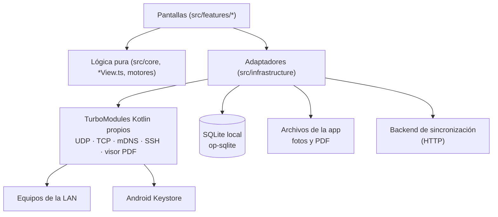
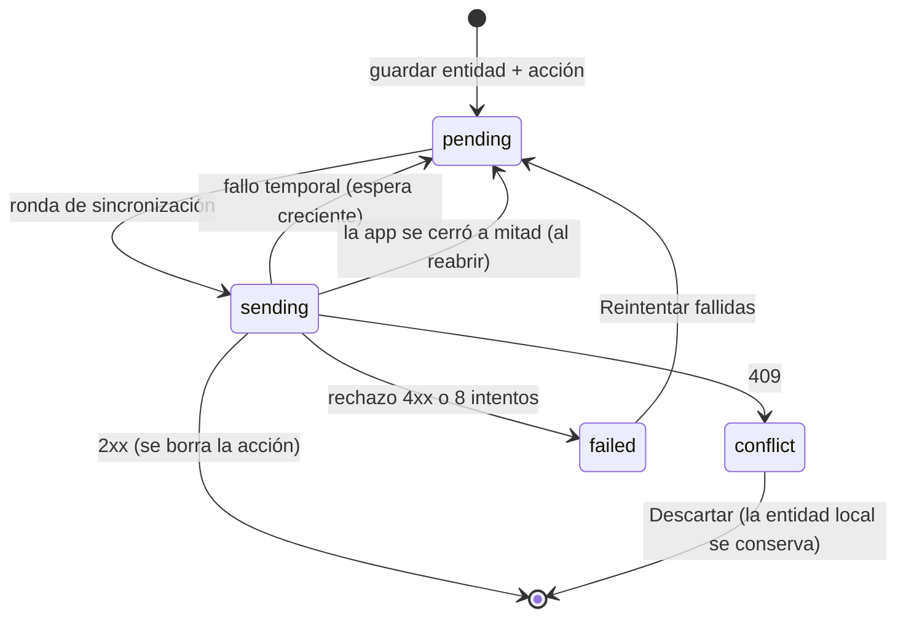

# Informe técnico · Network Diagnostics Suite (TP6)

Desarrollo de Aplicaciones Móviles 2026 · Fecha: 02/11/2026.

Este documento cubre lo que pide la consigna en el punto 7: el subconjunto del
protocolo SNMP implementado, el manejo de credenciales SSH y el diseño de la
cola offline. También justifica dónde el proyecto se aparta del stack sugerido
y separa lo verificado de lo pendiente. El detalle de cada prueba, con fechas y
comandos, está en [TRASPASO.md](TRASPASO.md) y [VERIFICACION.md](VERIFICACION.md).

## 1. Estado por requisito

| ID | Qué hace la app | Verificado | Pendiente |
| --- | --- | --- | --- |
| RF-01 | Busca servicios mDNS/DNS-SD y barre un rango de la LAN con sondas TCP; lista IP, puertos o servicios y hostname (si NSD lo entrega) | mDNS con un servicio controlado. Barrido desde el emulador sobre la LAN real `192.168.1.0/24`: encontró el router y otros equipos, confirmados desde la PC | La MAC no se puede obtener en Android 10+ (ver 6.1). mDNS de un equipo real necesita un teléfono |
| RF-02 | GetRequest SNMPv2c propio: sysName, sysUpTime, ifInOctets e ifOutOctets | Códec con pruebas de bytes; emulador → agente simulado y → net-snmp real (Linux en Docker) por UDP | Un equipo de red físico |
| RF-03 | SSH con comandos predefinidos, contraseña cifrada con el Keystore y huella del servidor verificada | Emulador → servidor simulado (incluido el cambio de huella) y → OpenSSH real (Linux en Docker) | Un equipo de red físico (Linux/OpenWrt, Cisco o MikroTik) |
| RF-04 | Lee QR/barras y muestra la ficha técnica del backend, con copia local para usarla sin red | QR leído con cámara real (webcam de la PC en el emulador); backend, código desconocido y modo avión | — |
| RF-05 | Instalación con fotos, GPS y notas, guardada en el teléfono | Emulador con GPS simulado | — |
| RF-06 | PDF de la instalación con notas, coordenadas y fotos, generado en el teléfono | Emulador: PDF de 2 páginas abierto con el visor del sistema | — |
| RF-07 | Cola outbox persistente, envío al backend con reintentos y conflictos | Emulador (debug y release): backend caído, envío completo, conflicto al volver la red | — |
| RF-08 | Historial por sitio y equipo leído de la base local | APK release abierto en modo avión | — |

## 2. Arquitectura

React Native 0.88 con la Nueva Arquitectura (TurboModules y Codegen),
TypeScript y Android como plataforma. Community CLI en lugar de Expo: el
proyecto necesita módulos nativos propios, que Expo Go no puede cargar.

Las capas de la consigna se corresponden con carpetas del código:

| Capa | Código |
| --- | --- |
| Discovery | `features/discovery` (`rangeScan.ts`), `MdnsDiscovery.kt`, `TcpProbe.kt` |
| Protocol | `core/snmp/codec.js`, `UdpExchange.kt`, `SshClientModule.kt`, `SshSecurity.kt` |
| Evidence | `features/evidence`, `features/identification` |
| Local Store | `infrastructure/storage` (migraciones, repositorio, outbox) |
| Sync | `features/sync` (motor, controlador, transporte HTTP), `backend/server.cjs` |
| Reporting | `features/reporting/installationPdf.ts`, `PdfViewerModule.kt` |

Regla del proyecto: la lógica que decide (códec SNMP, interpretación de salidas
SSH, política de reintentos, motor de sincronización, búsqueda de fichas) no
importa React Native. Se prueba en Jest con datos reales: bytes BER, SQLite en
memoria (`node:sqlite`) y el backend levantado en un puerto libre. Las
pantallas reciben sus servicios por props, así que también se prueban sin
dispositivo.

### 2.1 Diferencias con el stack sugerido

| Sugerido | Elegido | Motivo |
| --- | --- | --- |
| react-native-zeroconf | `NsdManager` de Android en un TurboModule propio | API del sistema, sin dependencia de terceros; compatible con la Nueva Arquitectura |
| react-native-udp / tcp-socket | `DatagramSocket` (`NativeUdpTransport`) y `SocketChannel` sin bloqueo (`NativeTcpProbe`) en TurboModules propios | SNMP solo necesita intercambiar un datagrama con plazo y cancelación; el barrido solo abre y cierra conexiones. Cada módulo valida destino, puertos y plazo, y la sonda TCP solo acepta IPv4 privadas |
| react-native-ssh-sftp | Módulo Kotlin propio con JSch 0.2.25 (fork mantenido `com.github.mwiede:jsch`) | La biblioteca 1.11.0 fija `StrictHostKeyChecking=no` (acepta cualquier servidor), conecta sin plazo, usa el puente viejo y JSch 0.2.17 |
| react-native-keychain | Cifrado AES-GCM con una clave del Android Keystore dentro del módulo SSH | La contraseña no vuelve nunca a JavaScript (ver 4) |
| vision-camera-code-scanner | `react-native-vision-camera-barcode-scanner` 5.2.3 (ML Kit) | Plugin oficial de VisionCamera v5; la salida de objetos de v5 es solo iOS. El modelo va en el APK y lee sin red |
| react-native-html-to-pdf | pdf-lib | JavaScript puro: genera el PDF sin WebView y se prueba en Jest con PDF reales. Contras: sin versiones desde 2022 y solo fuentes estándar (WinAnsi) |
| react-native-geolocation-service | `@react-native-community/geolocation` | Mantenida por la comunidad de React Native; alcanza para una lectura puntual con su antigüedad |
| WatermelonDB | SQLite con `@op-engineering/op-sqlite` y un repositorio propio | Transacciones explícitas (entidad + acción de la cola juntas) y menos configuración nativa con RN 0.88. La sincronización se implementa con el patrón outbox, no con el protocolo de WatermelonDB |
| NetInfo | `@react-native-community/netinfo` 12.0.1 | Se usa como se sugiere: dispara la sincronización al volver la red |

## 3. Subconjunto SNMP implementado

### 3.1 Alcance

- **Versión:** SNMPv2c (campo de versión = 1) con community string.
- **Operación:** solo GetRequest (`0xA0`) y su Response (`0xA2`). No hay Set,
  GetNext, GetBulk, Walk, traps ni SNMPv3.
- **Datos (MIB-II, RFC 1213):**

| Dato | OID | Tipo esperado |
| --- | --- | --- |
| sysName | `1.3.6.1.2.1.1.5.0` | OCTET STRING |
| sysUpTime | `1.3.6.1.2.1.1.3.0` | TimeTicks (centésimas de segundo) |
| ifInOctets | `1.3.6.1.2.1.2.2.1.10.N` | Counter32 |
| ifOutOctets | `1.3.6.1.2.1.2.2.1.16.N` | Counter32 |

  `N` es el índice de interfaz que elige el técnico. No se enumeran las
  interfaces del equipo (requeriría Walk sobre `ifTable`).

- Los cuatro OID viajan en una sola PDU.

### 3.2 Codificación BER propia

`src/core/snmp/codec.js` codifica y decodifica sin bibliotecas. Tipos
soportados:

| Tag | Tipo |
| --- | --- |
| `0x30` | SEQUENCE |
| `0x02` | INTEGER (con signo, hasta 32 bits) |
| `0x04` | OCTET STRING |
| `0x05` | NULL (valor de cada OID pedido) |
| `0x06` | OBJECT IDENTIFIER (dos primeros arcos combinados y base 128 en el resto) |
| `0x41` / `0x43` | Counter32 / TimeTicks (sin signo, hasta 2³²−1) |
| `0x80` / `0x81` | noSuchObject / noSuchInstance (excepciones de v2c) |

Límites defensivos: mensaje de hasta 8192 bytes; longitudes BER en forma corta
o larga de 1 o 2 bytes; hasta 32 variables por PDU; OID de hasta 128 arcos;
community de 1 a 255 caracteres ASCII imprimibles. Un entero con bytes de
relleno no mínimos, un largo que excede el mensaje o bytes sobrantes se
rechazan.

### 3.3 Validación de la respuesta

`decodeResponse` acepta la respuesta solo si coinciden:

1. versión 1 y la misma community;
2. el mismo request-id (aleatorio entre 1 y 2³¹−1 en cada consulta);
3. `error-status` = 0 (si no, informa el error y el índice);
4. los mismos OID en el mismo orden;
5. el tipo esperado para cada OID.

Un `noSuchObject`/`noSuchInstance` (por ejemplo, una interfaz inexistente) se
informa como error: un contador ausente nunca se muestra como cero.

### 3.4 Transporte UDP

`UdpExchange.kt`: un `DatagramSocket` conectado al destino (descarta
datagramas de otras direcciones), un envío, una recepción con
`soTimeout` y cancelación desde JavaScript. Valida antes de enviar: IPv4,
puerto 1–65535, carga de 1 a 8192 bytes y plazo de 100 a 15000 ms. Una
consulta a la vez (`E_BUSY`). No reintenta: UDP no garantiza entrega y el
técnico decide si repetir.

### 3.5 Seguridad y limitaciones

- SNMPv2c envía la community **sin cifrar**: cualquiera que capture el tráfico
  la ve. Por eso se usa solo en la red del laboratorio o de la instalación, y
  solo lectura.
- La community se conserva en memoria mientras la pantalla está abierta. No se
  guarda en la base, en los diagnósticos, en la cola ni en el PDF (verificado
  leyendo la base del emulador y el estado del backend).
- Counter32 desborda en 2³²−1. Se muestra el valor acumulado; no se calculan
  tasas a partir de una sola muestra.
- El agente de laboratorio (`npm.cmd run lab:snmp`, 127.0.0.1:1161) responde
  con valores controlados. Lo que falta es probar contra un equipo de red real.

### 3.6 Pruebas

- Jest: codificación y decodificación byte a byte, respuestas truncadas, de
  otra consulta, con otra community u otros OID, excepciones v2c y errores.
- `npm.cmd run test:snmp-lab`: intercambio UDP real con el agente en la PC.
- Instrumentación Android (`UdpTransportInstrumentation`): transporte, plazo y
  cancelación en el emulador.
- Emulador → PC (`10.0.2.2:1161`): sysName `TP6-LAB-PC`, uptime y contadores;
  community incorrecta → plazo vencido; cancelación.
- Emulador → **net-snmp real** (`snmpd` de Debian en Docker,
  `npm.cmd run lab:linux`, comunidad `tp6-lab`):
  - sysName `tp6-linux-lab`;
  - uptime coincidente con el arranque del contenedor;
  - contadores reales de `eth0` (interfaz 2).

  El códec interoperó con una implementación de terceros sin cambios.

## 4. Manejo de credenciales SSH

### 4.1 Riesgos considerados

1. Contraseña legible en el teléfono (archivos, base, copias de seguridad, logs).
2. Contraseña entregada a un servidor falso (intermediario en la red).
3. Ejecución de comandos arbitrarios en un equipo de producción.

### 4.2 Almacenamiento

- La contraseña se cifra con **AES-256-GCM** usando una clave generada en el
  **Android Keystore** (no exportable).
- La referencia `ssh:<ip>:<puerto>` va como dato autenticado (AAD): un texto
  cifrado copiado a otro equipo no se descifra.
- En SharedPreferences quedan solo usuario, IV y texto cifrado. La app tiene
  `allowBackup=false`.
- JavaScript envía la contraseña una sola vez, al guardarla, y no tiene forma de
  leerla. El módulo la descifra al conectar y borra el arreglo después de usarlo.
- Verificado en el emulador: ni la contraseña correcta ni una incorrecta
  aparecen en la base, en la cola ni en las preferencias.

### 4.3 Identidad del servidor (TOFU)

- En la primera conexión, la app obtiene la clave del servidor y muestra su
  huella **SHA256 en formato OpenSSH**. El técnico la compara con la del equipo
  y la confirma.
- Desde entonces solo se acepta esa huella. JSch la verifica durante el
  intercambio de claves, **antes de autenticar**: si no coincide, la contraseña
  no se envía (`E_HOST_KEY_CHANGED`).
- Aceptar una huella nueva exige "Olvidar huella guardada" de forma explícita.

### 4.4 Comandos

- Lista cerrada en Kotlin (`SshCommands`). JavaScript envía perfil + nombre de
  comando, nunca texto libre.
- Linux: `uptime` e `ip -brief address`, con interpretación de la salida.
- Cisco IOS y RouterOS están definidos pero sin probar con equipos reales; su
  salida se muestra tal cual.
- Límites: plazo total, salida máxima de 64 KB (en la base se guardan hasta
  8000 caracteres), un hilo por conexión y cancelación.
- Errores tipados: `E_HOST_KEY_UNKNOWN`, `E_HOST_KEY_CHANGED`, `E_AUTH`,
  `E_NO_CREDENTIAL`, `E_TIMEOUT`, `E_UNREACHABLE`, `E_CANCELLED`.

### 4.5 Pruebas

Laboratorio `npm.cmd run lab:ssh` (127.0.0.1:2222; no ejecuta nada en la PC,
devuelve salidas simuladas):

- La huella mostrada en el emulador coincidió con la del laboratorio.
- Contraseña incorrecta → "Usuario o contraseña incorrectos".
- Clave del servidor cambiada → conexión rechazada sin enviar la contraseña.
- Servidor detenido → "puerto cerrado o equipo inaccesible".

Contra **OpenSSH real** (Debian en Docker, `npm.cmd run lab:linux`):

- La huella mostrada coincidió con la clave ECDSA del servidor.
- Contraseña incorrecta: rechazada.
- `uptime` e `ip -brief address` devolvieron la salida real del sistema.
- Ni la contraseña ni la comunidad SNMP quedaron en la base ni en las
  preferencias.

## 5. Diseño de la cola offline (outbox)

### 5.1 Principio

Toda acción del técnico se confirma contra la base local, nunca contra la red.
El envío al backend es una tarea aparte que puede ocurrir minutos u horas
después. La app no confunde "tengo Wi-Fi" con "el backend responde": antes de
cada ronda consulta `GET /health`.

### 5.2 Escritura atómica

Cada cambio guarda la entidad y su acción de la cola **en la misma transacción
SQLite** (`saveDiagnosticWithAction`, `saveInstallationWithAction`,
`saveReportWithAction`). No puede quedar una instalación sin su envío pendiente
ni un envío de algo que no existe.

| Acción | Entidad | Archivos |
| --- | --- | --- |
| `diagnostic.upsert` | Diagnóstico SNMP o SSH | — |
| `installation.upsert` | Instalación (notas, GPS, fotos) | JPEG de cada foto |
| `report.upload` | Reporte de una revisión de la instalación | PDF |

Cada acción guarda id estable, entidad, **revisión**, estado, intentos, próximo
intento y último error. Una revisión nueva de la misma entidad reemplaza la
acción pendiente anterior: no se envían versiones intermedias.

### 5.3 Estados

- **Espera creciente:** 30 s, 1 min, 2 min… hasta 30 min. Después de 8 intentos
  la acción queda `failed` hasta que el técnico la reintente.
- **Corte de ronda:** un fallo temporal corta la ronda; probablemente se perdió
  la red, y seguir gastaría intentos de las demás acciones.
- **Recuperación:** al abrir la base, las acciones que quedaron `sending` vuelven a
  `pending` y se reenvían con el mismo id.

### 5.4 Idempotencia y conflictos (contrato con el backend)

El backend de laboratorio (`backend/server.cjs`, Node sin dependencias,
persistente en `tmp/backend`) implementa el contrato:

| Pedido | Resultado |
| --- | --- |
| `POST /sync/actions` con un `actionId` ya aplicado y el mismo contenido | 200, sin aplicarlo otra vez |
| El mismo `actionId` con otro contenido | 422 |
| El servidor tiene una revisión mayor, o la misma con otro contenido | 409 |
| Falta un archivo referenciado | 422 |
| `POST /sync/files` con SHA-256 que no coincide, o un `fileId` ya usado con otro contenido | 422 (solo JPEG y PDF, hasta 20 MB) |

Los archivos se suben antes que la acción que los referencia, en base64 con su
SHA-256. La entidad enviada no contiene rutas locales del teléfono: referencia
los archivos por `fileId`.

Regenerar el PDF de una revisión ya enviada produce otro archivo (cambia la
fecha de generación). Por eso el reporte lleva una **generación**: es la
revisión con la que se sincroniza y forma parte del `fileId`
(`rep-<instalación>-r<revisión>-g<generación>`). El backend la recibe como una
revisión mayor con un archivo nuevo, en vez de rechazarla por repetir el
`fileId`. Este caso apareció al grabar el video: el PDF regenerado quedaba en
"Fallidas" sin poder enviarse.

Clasificación en la app (`httpTransport.ts`): 2xx éxito; 409 conflicto; 408,
429, 5xx y errores de red, temporales; otros 4xx, permanentes.

**Conflicto:** la app no fusiona ni sobrescribe. Muestra la acción con el
mensaje del backend y ofrece "Descartar (conserva los datos locales)": se
retira el envío, el dato sigue en el teléfono (historial, PDF) y el backend
conserva su versión.

### 5.5 Disparadores

Una sola ronda a la vez (`syncController.ts`):

- al abrir la app y al volver a primer plano;
- cada 60 s con la app en primer plano;
- al pasar de sin red a con red (NetInfo);
- con "Sincronizar ahora".

La URL del backend se guarda en la base y se lee en cada ronda.

### 5.6 HTTP en el APK release

El backend de laboratorio usa HTTP. En release, `network_security_config.xml`
bloquea HTTP sin cifrar salvo hacia la PC del laboratorio:

- `10.0.2.2`: la PC vista desde el emulador;
- `127.0.0.1` y `localhost`: un teléfono por USB con `adb reverse tcp:3000 tcp:3000`.

Cualquier otro backend debe usar HTTPS, y la pantalla rechaza guardar una URL
HTTP hacia otro host. Habilitar HTTP en general habría enviado fotos,
coordenadas y diagnósticos sin cifrar por la red de la instalación. La
compilación debug permite HTTP porque Metro lo usa.

### 5.7 Pruebas

- **Jest:** motor contra el backend real (envío completo, reenvío tras cierre sin
  duplicar, conflicto y descarte, backend apagado), controlador (una ronda a la
  vez, red recuperada, intervalo), pantalla y backend (`npm.cmd run test:backend`).
- **Emulador, con 7 acciones pendientes** (2 SNMP, 3 SSH, instalación con 2 fotos,
  PDF):
  - Backend caído: la cola no cambió y no se gastaron intentos.
  - Backend arriba: se enviaron 7 acciones y 3 archivos, con el SHA-256 de cada
    archivo igual en el teléfono y en el backend.
  - Conflicto: se cargó en el backend una revisión mayor de un diagnóstico y se
    activó el modo avión. Al desactivarlo, la app mostró el 409 en una ronda
    disparada por NetInfo, y "Descartar" conservó el dato local.
- **APK release:**
  - Abrió sin red y mostró el historial.
  - Sincronizó por HTTP a `10.0.2.2` y a `127.0.0.1` con `adb reverse`.
  - Rechazó una URL HTTP de la LAN.

## 6. Otros módulos

### 6.1 Descubrimiento (RF-01) y la MAC

La app busca servicios DNS-SD/mDNS (`_http`, `_https`, `_ssh`, `_workstation`,
`_ipp`, `_printer`, `_smb`) con `NsdManager`, con plazo de 1 a 30 s y
cancelación. Agrupa por IP y muestra el hostname cuando NSD lo entrega
(Android 16 / API 36+).

**Barrido de rango.** Un equipo que no anuncia servicios mDNS no aparece en
esa búsqueda. Por eso la app también barre un rango de la LAN, como el
"escaneo ARP-like sobre la subred" con sockets TCP que sugiere la consigna:

- Rango: `192.168.1.1-254`, una red de /24 a /30 o una IP, hasta 256
  direcciones. Sugiere la /24 del teléfono. Solo redes privadas (RFC 1918),
  validado en JavaScript y otra vez en el módulo nativo.
- Por cada IP intenta una conexión TCP a 22, 23, 80, 443, 8080 y 8291
  (SSH, Telnet, web y MikroTik Winbox), con plazo de 700 ms. No envía datos:
  abre y cierra.
- `TcpProbe.kt` abre las conexiones de una IP en paralelo con `SocketChannel`
  sin bloqueo y un `Selector`; JavaScript (`rangeScan.ts`) sondea 32 IP a la
  vez y muestra el progreso. Se puede cancelar.
- Un equipo cuenta como activo si **acepta** al menos una conexión. Un rechazo
  no cuenta: en el emulador las conexiones salen por la PC, y un rechazo no
  prueba que el equipo exista. Un equipo con todos esos puertos cerrados no
  aparece.
- Los equipos encontrados se guardan con `discoveryMethod: 'tcp-probe'` y
  desde su detalle se abre la consulta SNMP.

En el emulador, mDNS no recibe los anuncios de la LAN, pero el barrido sí
llega a sus IP a través de la PC. Sobre `192.168.1.1-254` tardó unos 11 s y
encontró el router (`192.168.1.1`: Telnet, HTTP y HTTPS) y otros equipos con
HTTP. Cada resultado coincidió con una sonda desde la PC, y los equipos de la
LAN con esos puertos cerrados no aparecieron.

**MAC:** desde Android 10 las apps no pueden leer la tabla ARP
(`/proc/net/arp`) ni las MAC de otros equipos. Un escaneo "ARP-like" desde la
app no es posible sin root: el barrido TCP encuentra equipos, pero no su MAC.
La app muestra "MAC: no disponible en Android 10+" en lugar de inventarla.

### 6.2 Evidencia y PDF (RF-05, RF-06)

- **Fotos:** VisionCamera 5, guardadas en `files/evidence`.
- **GPS:** se georreferencia una foto si la lectura tiene menos de 5 minutos;
  si no, queda marcada "sin GPS".
- **PDF:**
  - Lo genera pdf-lib en el teléfono, en A4: cabecera (sitio, equipo,
    revisión, fechas, GPS), notas con ajuste de línea y cada foto con su fecha
    y coordenadas.
  - Respeta la orientación EXIF: el sensor guarda las fotos giradas.
  - Lo abre el visor del sistema mediante un `FileProvider` propio, que solo
    comparte la carpeta de reportes.

### 6.3 Identificación (RF-04)

- **Lectura:** QR, Code 128, Code 39 y Data Matrix con ML Kit en el teléfono.
- **Código:** se valida (3 a 64 caracteres) y se normaliza a mayúsculas.
- **Ficha:** primero se muestra la copia local y después se consulta
  `GET /technical-sheets/:code`, cuya respuesta reemplaza la copia.
- **Sin ficha:** la app distingue "no hay ficha para ese código" (404) de "sin
  conexión y nunca se descargó".

## 7. Verificación

- `npm.cmd run verify` (TypeScript, ESLint, Jest y bundle Android): 203 pruebas
  en 17 suites al 03/11/2026. Más `test:backend`, `test:snmp-lab` y
  `test:ssh-lab` con Node.
- Las pruebas en el emulador Android 16 (API 36) están descritas paso a paso en
  [TRASPASO.md](TRASPASO.md), con capturas en [evidencia/](evidencia/).
- Cada afirmación de este informe marcada como verificada tiene su prueba ahí.
  Lo que solo se probó en laboratorio figura como pendiente en la sección 1.

## 8. Limitaciones y trabajo pendiente

- Pruebas con un teléfono Android: mDNS con equipos reales de la LAN (el
  barrido ya encontró equipos reales desde el emulador).
- SNMP y SSH contra un equipo de red físico. Ya se probaron contra net-snmp y
  OpenSSH reales, pero en un contenedor de la PC. El router de la casa no
  ofrece SNMP en su administración.
- MAC de los equipos: no se puede obtener desde una app en Android 10+.
- SNMP sin v3: sin autenticación ni cifrado. Para producción correspondería
  SNMPv3 (USM).
- El backend es un stub de laboratorio: sin autenticación de usuarios ni HTTPS.
  La app ya exige HTTPS en release para cualquier backend que no sea la PC del
  laboratorio.
- El APK release está firmado con la clave debug. Alcanza para la entrega, no
  para publicar.
- Conflictos: solo se informan y se descartan; no hay fusión de versiones.

## 9. Referencias

- RFC 1157, *A Simple Network Management Protocol (SNMP)*.
- RFC 3416, *Version 2 of the Protocol Operations for SNMP*.
- RFC 1213, *MIB-II*.
- RFC 4253, *The Secure Shell (SSH) Transport Layer Protocol* (verificación de
  la clave del servidor).
- OWASP MASVS, almacenamiento de datos y criptografía.
- Martin Fowler / Chris Richardson, patrón *Transactional Outbox*.
- Documentación de Android: NSD, Keystore, Network Security Configuration,
  restricciones de acceso a MAC desde Android 10.
